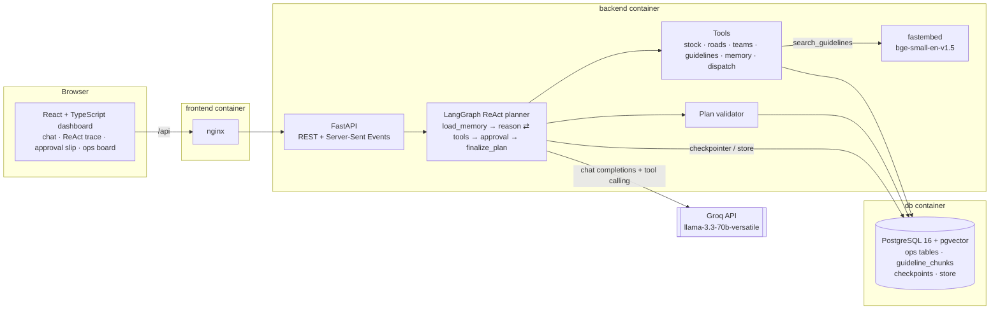

# Architecture

Ark-Agent is one repository with three deployable parts, run together by Docker Compose.



## Layers (backend)

| Layer | Package | Depends on | Notes |
|-------|---------|------------|-------|
| Domain | `app/domain` | nothing | Pydantic v2 models and enums; no I/O. `extra="forbid"`, constrained ids, cross-field validators. |
| Data access | `app/repositories`, `app/db` | domain | `OpsRepository` Protocol with a Postgres implementation (SQLAlchemy, row locks) and an in-memory one; both pass the same contract tests. |
| Knowledge | `app/rag` | domain, db | Chunk, embed, index (pgvector or in-memory), retrieve with a calibrated threshold. |
| Memory | `app/memory` | LangGraph | Postgres checkpointer (short-term) and store (long-term facts). |
| Tools | `app/tools` | repositories, rag, memory | LangChain tools with Pydantic argument schemas; `run_tool` turns every failure into a `ToolResult`. |
| Agent | `app/agent` | tools, validator | The LangGraph `StateGraph`, prompts, routing, Groq client with retries. |
| API | `app/api` | agent, repositories | FastAPI routers, SSE streaming, application container (wiring). |
| Evaluation | `app/evaluation`, `scripts/` | agent | Scenario runner, metrics, trace reports, demos. |

Dependencies point downwards only. The agent never imports SQLAlchemy, and the domain never
imports anything else, so storage can be swapped (tests use in-memory implementations
throughout).

## Request lifecycle

```mermaid
sequenceDiagram
    actor C as Coordinator
    participant UI as Dashboard
    participant API as FastAPI
    participant G as LangGraph
    participant LLM as Groq
    participant DB as Postgres

    C->>UI: "Ward 7 needs drinking water for 300 people by evening"
    UI->>API: POST /threads/{id}/messages (SSE)
    API->>G: stream(messages, thread_id)
    G->>DB: load facts for W-07 (store)
    loop ReAct, at most 8 steps
        G->>LLM: system prompt + history + tool schemas
        LLM-->>G: Thought + tool calls
        G->>DB: stock / roads / teams / pgvector search
        G-->>UI: thought, tool_call, tool_result events
    end
    LLM-->>G: create_dispatch_task(plan)
    G->>DB: validate plan against live data
    G-->>UI: interrupt (dispatch slip)
    Note over G,DB: run paused; state checkpointed in Postgres
    C->>UI: Approve
    UI->>API: POST /threads/{id}/resume {"decision": "approve"}
    API->>G: Command(resume=...)
    G->>DB: reserve stock + deploy team (one transaction), save facts
    G-->>UI: answer + done(status=dispatched)
```

## Key design decisions

| Decision | Alternatives | Why |
|----------|--------------|-----|
| Custom `StateGraph` instead of the prebuilt `create_react_agent` | prebuilt agent; plan-and-execute | The case study asks for explicit reasoning, tool and finalisation nodes with explained edges, stop conditions and a human checkpoint. Custom nodes make each one visible and testable. |
| Validate plans **before** the human sees them | let the coordinator catch mistakes | Coordinators are tired; a plan over a blocked road or with phantom stock should never reach them. The LLM gets the violations and re-plans. |
| Re-validate inside the dispatch transaction | trust the earlier check | Another dispatch may have taken the stock while the coordinator was deciding. Row locks plus CHECK constraints make over-allocation impossible. |
| One Postgres for everything | separate vector DB (Qdrant/Chroma), Redis for memory | Fewer moving parts. pgvector, LangGraph's Postgres saver/store and relational data share backups, transactions and one container. |
| Local embeddings (fastembed) | embedding API | No second external service, works offline, free. Groq offers no embedding endpoint. |
| SSE instead of WebSockets | WebSockets, polling | One-way server→client streaming over plain HTTP; works through nginx with buffering off. |
| Deterministic final messages after approve/reject | another LLM call | Saves a step and tokens; the outcome text cannot drift from what was actually stored. |
| Fake LLM in unit tests | call Groq in tests | Fast, free, deterministic; every routing path (step limit, approval, revise, invalid plan) is pinned. |
