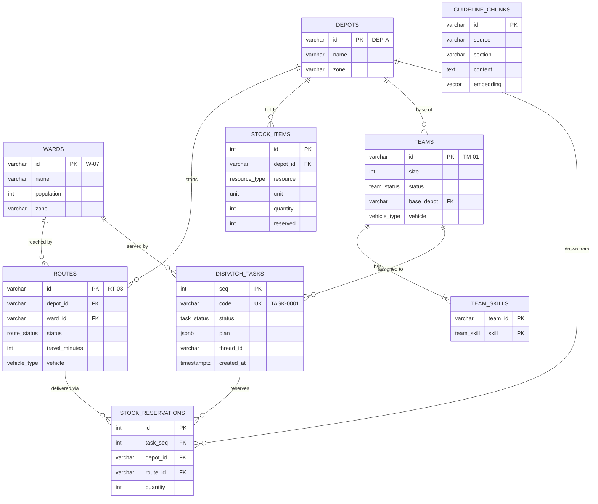

# Database

Ark-Agent keeps all persistent state in a single **PostgreSQL 16 + pgvector** instance
(`docker compose up -d db`). The schema is owned by **Alembic** (`backend/migrations/`) and
mapped with **SQLAlchemy 2.0** (`backend/app/db/models.py`).

| Concern | Tables | Owner |
|---------|--------|-------|
| Operational data | `wards`, `depots`, `stock_items`, `routes`, `teams`, `team_skills` | Alembic |
| Decisions & audit | `dispatch_tasks`, `stock_reservations` | Alembic |
| RAG index | `guideline_chunks` (`vector(384)`, HNSW cosine index) | Alembic |
| Short-term agent memory | `checkpoints`, `checkpoint_blobs`, `checkpoint_writes`, … | LangGraph `PostgresSaver.setup()` |
| Long-term agent memory | `store`, … | LangGraph `PostgresStore.setup()` |

## Entity-relationship diagram



## Integrity rules enforced by the database

- Native enum types (`resource_type`, `route_status`, `team_status`, `task_status`, …) mirror the
  Python `StrEnum`s in `app/domain/enums.py`, so invalid values are rejected at both layers.
- `stock_items`: `quantity >= 0`, `reserved >= 0`, **`reserved <= quantity`**, and one row per
  `(depot_id, resource)`.
- `routes.travel_minutes > 0`; `teams.size BETWEEN 1 AND 50`; `stock_reservations.quantity > 0`.
- Foreign keys tie routes, teams, tasks and reservations to existing wards, depots and teams.

## Concurrency: dispatching without over-drawing stock

`SqlOpsRepository.dispatch` runs in one transaction:

1. `SELECT … FOR UPDATE` on the team row and on every `stock_items` row the plan touches (ordered
   by depot id, so lock order is the same for every transaction and it cannot deadlock).
2. Re-validate the plan against the locked rows (`app/repositories/rules.py`): ward and team exist,
   team available, each route connects its depot to the ward and is not blocked, enough stock is
   available.
3. Increment `reserved`, mark the team `deployed`, insert the task and its reservations.

If any step fails, the transaction rolls back and nothing changes. The `reserved <= quantity`
CHECK is a final safety net.

## Seeding and reset

`app/db/seeder.py` loads `app/db/seed/*.json` (validated by `SeedData`) on startup only if the
tables are empty. `POST /api/ops/reset` (and `repo.reset()`) truncates the operational tables,
restarts task numbering and re-seeds. The RAG index is left untouched.

## Migrations

```bash
cd backend
uv run alembic upgrade head      # apply
uv run alembic downgrade base    # drop everything (tables + enum types)
uv run alembic revision --autogenerate -m "describe change"
```

## Tests

The same behavioural contract (`tests/contract/ops_repo_contract.py`) runs against the in-memory
repository (unit suite) and the Postgres repository (`uv run pytest -m integration`, using a
separate `<db>_test` database).
