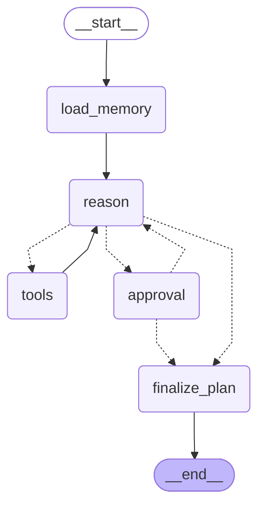

# Agent Graph (ReAct with LangGraph)

The planner is a custom LangGraph `StateGraph` (`backend/app/agent/graph.py`). It implements the
**ReAct** pattern: the model *reasons*, *acts* by calling a tool, *observes* the result and loops
until it can propose a plan. Explicit stop conditions and a human checkpoint sit around that loop.

## Diagram (generated from the compiled graph)

Regenerate with `cd backend && uv run python -m scripts.export_graph`. Dashed arrows are
conditional edges.

## Nodes

| Node | What it does | Writes to state |
|------|--------------|-----------------|
| `load_memory` | Entry point for every new request. Finds wards mentioned in the request and loads their long-term facts from the store; resets the per-request step counter. | `memory_context`, `step_count = 0`, `status = running` |
| `reason` | One ReAct step: system prompt (procedure, current time, remembered facts) + conversation → Groq LLM with tools bound. Retries Groq `tool_use_failed` / rate-limit errors with backoff. | new `AIMessage`, `step_count + 1` |
| `tools` | Executes the read-only tool calls of the last step through `run_tool`, so invalid arguments and repository errors come back as structured `ToolResult` errors the model can recover from. | one `ToolMessage` per call |
| `approval` | **Human-in-the-loop checkpoint.** Validates the proposed `ReliefPlan` (schema + `validate_plan`); invalid plans go back to `reason` with the violations. A valid plan pauses the run with `interrupt()`. On resume it applies the coordinator's decision. | `ToolMessage`s, `status`, `proposed_plan`, `dispatched_task` |
| `finalize_plan` | Closes the request: on step limit it answers dangling tool calls and explains; on dispatch or rejection it writes a definite summary; otherwise the model's answer stands. | final `AIMessage`, `status` |

## Edges

| From → To | Kind | Condition | Why |
|-----------|------|-----------|-----|
| `START → load_memory` | fixed | every invocation with a new message | Each request starts with relevant long-term memory and a fresh step budget. |
| `load_memory → reason` | fixed | always | Begin the ReAct loop. |
| `reason → tools` | conditional | the step made only read-only tool calls and the budget is not used up | *Act* then *observe*. |
| `tools → reason` | fixed | always | Feed observations back for the next thought. **This is the ReAct loop.** |
| `reason → approval` | conditional | a call to `create_dispatch_task` (any tool in `APPROVAL_REQUIRED`), even when mixed with read-only calls | Side effects always pass the human checkpoint. |
| `reason → finalize_plan` | conditional | no tool calls (the model answered or asked a question), **or** `step_count ≥ max_steps` (default 8) | Stop conditions: plan complete / human input needed / tool budget used. |
| `approval → reason` | `Command(goto)` | the plan fails validation, the coordinator chooses **revise** (with a note), or the dispatch fails because stock changed | Give the model the reason so it can re-plan. |
| `approval → finalize_plan` | `Command(goto)` | coordinator **approves** (stock reserved, team deployed) or **rejects** | The request has a definite outcome. |
| `finalize_plan → END` | fixed | always | Thread state is checkpointed; the next message continues the thread. |

## Stop conditions

1. **Plan complete:** after approval or rejection (`status = dispatched | rejected`), or when the
   model answers without tools (`answered`).
2. **Human input needed:** the model asks a clarifying question (no tool calls), or the run is
   paused at `interrupt()` awaiting the coordinator.
3. **Tool budget used:** `step_count` reached `max_steps` (8 by default, overridable per run with
   `configurable.max_steps`). Pending calls are answered with "not executed" so the history stays
   valid, and the coordinator is told nothing was dispatched (`status = step_limit`).

## Approval checkpoint details

- `interrupt()` is called **before any write**. LangGraph re-executes the node from the top when
  the run is resumed, so validation runs again against fresh data. A plan that became infeasible
  while the coordinator was deciding (e.g. stock taken by another dispatch) is caught.
- Resume payload (validated by `ApprovalDecision`):
  `{"decision": "approve" | "reject" | "revise", "note": "..."}`. `revise` requires a note.
- Approve → `repo.dispatch()` reserves stock and deploys the team in one transaction, then
  writes `decision` and `reservation` facts to long-term memory.
- Reject / revise → `repo.record_rejection()` (audit trail, no reservation) and a `rejection` fact.
- Every tool call in the paused step receives exactly one `ToolMessage`, whatever the outcome, so
  the conversation can always continue (tested by `assert_history_valid`).

## Plan validation (`app/agent/validator.py`)

A plan is valid only if: the ward exists; `quantity_required` meets the SOP minimum for the
number of people (3 L water / person, 1 ration / person, 1 medicine kit / 50, 1 shelter kit / 5);
the team exists, is available, has the required skill (medicine → medical) and a vehicle that
matches each route (boat-only routes need a boat crew); every route exists, links its depot to
the ward and is not blocked; each depot has the allocated stock available; the ETA is not shorter
than the slowest route; and every citation was actually retrieved in this request.
