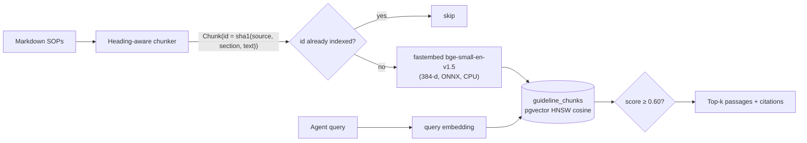

# Retrieval-Augmented Generation (RAG)

The agent grounds its quantity calculations and routing rules in the centre's **relief SOPs**
(`backend/app/knowledge/*.md`) via the `search_guidelines` tool. Every guideline the agent uses
in a plan must be cited as `<source>#<section>`, and the plan validator rejects citations that
were never retrieved in that run.

## Corpus

| File | Covers |
|------|--------|
| `sop-dispatch-protocol.md` | Planning steps, route selection, ETA rule, approval, partial plans |
| `sop-water-supply.md` | 3 L (4 L hot) drinking water per person per day, 20 L jerrycans, splitting across depots |
| `sop-food-rations.md` | 1 packet per person per day, special diets |
| `sop-medical-supplies.md` | 1 kit per 50 people for 3 days, medical escort, scarcity rule |
| `sop-boat-operations.md` | Boat-only routes, 500 L or 150 packets per trip, safety limits |
| `sop-shelter.md` | 1 shelter kit per household of five, blankets |
| `sop-road-closures.md` | Open / slow (+50 %) / blocked semantics, road reports |
| `sop-shift-handover.md` | What to record in operational memory, duplicate requests |
| `sop-priority-triage.md` | Critical / high / medium / low |

The documents are representative but fictional, modelled on common humanitarian standards. Their
numbers are consistent with the seed data so that the scenarios exercise them.

## Pipeline

- **Chunking** (`rag/chunker.py`): one chunk per `##` section, so citations point to meaningful
  units. Sections longer than 1,600 characters split on paragraph boundaries with 240 characters
  of overlap.
- **Idempotent ingestion** (`rag/ingest.py`): chunk ids are content hashes. Re-running ingestion
  embeds only new or edited chunks and deletes chunks that no longer exist. The backend syncs on
  startup, and a second run reports `added=0`.
- **Index** (`rag/pgvector_index.py`): upsert with `ON CONFLICT DO UPDATE`, search ordered by
  pgvector cosine distance `<=>` (score = 1 − distance).
- **Embedding** happens locally inside the backend; no embedding API is called. The model is
  cached in `backend/.fastembed_cache` (a Docker volume in Compose).

## Threshold calibration

Scores from `bge-small-en-v1.5` over the corpus (top hit):

| Query | Top citation | Score |
|-------|--------------|-------|
| how much drinking water per person | `sop-water-supply.md#daily-allowance` | 0.857 |
| boat capacity per trip | `sop-boat-operations.md#capacity` | 0.817 |
| medicine kits needed for 200 people | `sop-medical-supplies.md#kit-ratio` | 0.839 |
| can we use a blocked road | `sop-road-closures.md#re-routing` | 0.784 |
| bitcoin price today *(off-topic)* | `sop-food-rations.md#ration-size` | 0.535 |
| recipe for chocolate cake *(off-topic)* | `sop-water-supply.md#quality-and-handling` | 0.478 |

Relevant hits score ≥ 0.69 and off-topic queries ≤ 0.54, so `RAG_MIN_SCORE` defaults to **0.60**.
Below that the tool returns "No relevant guideline found" rather than misleading context.

## Testing

Unit tests use a deterministic `HashEmbedder` and an in-memory index (offline). The integration
test runs the same sync and search against pgvector.
